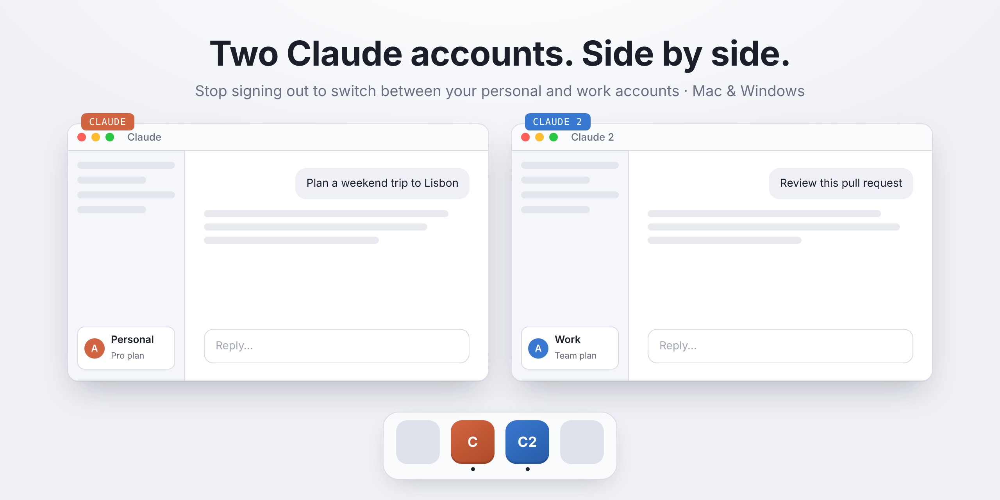

# Claude Multi Account

🇬🇧 [English version](README.md)

> **Progetto originale / Crediti:** Questo repository è un fork/estensione del progetto originale [**`andrea6687/claude-multi-account`**](https://github.com/andrea6687/claude-multi-account) realizzato da **Andrea Sportello** ([pagina web](https://andrea6687.github.io/claude-multi-account/)), creato per aggiungere il supporto a **Linux** oltre a macOS e Windows, e per estendere il sistema anche a **OpenAI Codex** (`install-codex.sh`) e **Google Antigravity** (`install-antigravity.sh`).

**Basta uscire e rientrare per passare dall'account personale a quello di lavoro su Claude, Codex o Antigravity.**



Usa **due account di Claude Desktop insieme**, ognuno con il suo login, su Mac, Windows o Linux.
Lo script crea una seconda app (es. "Claude 2") che avvia Claude Desktop con una cartella dati separata, e le dà un'icona di un altro colore. L'app Claude originale non viene modificata.

👉 **Pagina con interfaccia:** https://andrea6687.github.io/claude-multi-account/
Scegli nome e colore, copia il comando e incollalo.

## Installazione rapida

**Mac / Linux** – apri il Terminale e incolla:
```bash
curl -fsSL https://raw.githubusercontent.com/andrea6687/claude-multi-account/main/install.sh | bash
```
- **Mac:** Claude Desktop (l'app scaricata da claude.ai/download) viene cercato in `/Applications`, poi in `~/Applications`, poi ovunque sul Mac con Spotlight. Per usare una copia precisa: `curl -fsSL https://raw.githubusercontent.com/andrea6687/claude-multi-account/main/install.sh | CLAUDE_APP="/percorso/di/Claude.app" bash`
- **Linux:** Claude Desktop (`claude-desktop`) viene cercato nei percorsi standard (`/usr/bin/claude-desktop`, `/opt/Claude`, ecc.), nei file `.desktop`, in Flatpak e nelle AppImage. Per usare un eseguibile specifico: `curl -fsSL https://raw.githubusercontent.com/andrea6687/claude-multi-account/main/install.sh | CLAUDE_APP="/percorso/di/claude-desktop" bash`

**Windows** – apri PowerShell e incolla:
```powershell
irm https://raw.githubusercontent.com/andrea6687/claude-multi-account/main/install.ps1 | iex
```

Lo script chiede il nome dell'app e il colore dell'icona (blu, verde, viola, rosa, azzurro, giallo, nessuno). Gli script parlano italiano se il computer è impostato in italiano.

Il nome viene ripulito dagli spazi all'inizio e alla fine. Non può essere vuoto, non può essere `Claude` o `AnthropicClaude`, e deve contenere almeno una lettera o un numero. Solo lettere, numeri, spazi, `-` e `_`.

Con nome e colore già scelti:

**Mac / Linux**
```bash
curl -fsSL https://raw.githubusercontent.com/andrea6687/claude-multi-account/main/install.sh | bash -s -- "Claude 2" blue
```

**Windows**
```powershell
& ([scriptblock]::Create((irm https://raw.githubusercontent.com/andrea6687/claude-multi-account/main/install.ps1))) "Claude 2" blue
```

### OpenAI Codex & Google Antigravity (Mac / Linux)

Sono inclusi anche gli script dedicati per **OpenAI Codex Desktop** (`install-codex.sh`, che isola sia `--user-data-dir` sia `CODEX_HOME`) e **Google Antigravity** (`install-antigravity.sh`, che isola `--user-data-dir` e `--extensions-dir`):

**OpenAI Codex**
```bash
# Installazione:
curl -fsSL https://raw.githubusercontent.com/Symon180/claude-multi-account_for_linux/main/install-codex.sh | bash -s -- "Codex 2" blue
# Rimozione:
curl -fsSL https://raw.githubusercontent.com/Symon180/claude-multi-account_for_linux/main/install-codex.sh | bash -s -- --uninstall "Codex 2"
```

**Google Antigravity**
```bash
# Installazione:
curl -fsSL https://raw.githubusercontent.com/Symon180/claude-multi-account_for_linux/main/install-antigravity.sh | bash -s -- "Antigravity 2" purple
# Rimozione:
curl -fsSL https://raw.githubusercontent.com/Symon180/claude-multi-account_for_linux/main/install-antigravity.sh | bash -s -- --uninstall "Antigravity 2"
```

## Il primo accesso (importante)

Nella nuova app **non usare "Continua con Google"**. Scrivi l'email, premi **"Continua con email"** e incolla nella finestra il **codice** che ricevi via email. Se clicchi il link nell'email, il sistema apre l'altro Claude e il login finisce lì.
In alternativa: chiudi del tutto il Claude principale prima di accedere.

## Come funziona

Claude Desktop accetta l'opzione `--user-data-dir`, che indica dove salvare login e impostazioni. La nuova app avvia lo stesso Claude con una cartella diversa, quindi le due istanze non si vedono e restano loggate ognuna con il suo account. Gli aggiornamenti di Claude valgono per entrambe.

- **Mac:** l'app viene creata in `~/Applications`. Login e impostazioni stanno in `~/Library/Application Support/ClaudeMultiAccount/<nome>/`. Per avere l'icona colorata anche nel Dock mentre l'app è aperta, una copia "clone" APFS di Claude.app sta in `~/Library/Application Support/ClaudeMultiAccount/apps/<nome>.app`, fuori dalla cartella dati: su disco APFS non occupa spazio in più. La copia può aggiornarsi da sola; viene ricreata dal Claude installato solo quando quello è più nuovo, mai mentre la copia è in esecuzione.

  **Guardiano:** quando Claude si aggiorna da solo (di solito di notte) si riavvia senza l'opzione `--user-data-dir`, quindi la seconda app tornerebbe collegata all'account principale. Succede lo stesso se apri la copia da un'icona fissata nel Dock mentre era aperta, o se macOS la riapre all'accesso. Un piccolo processo in background (`~/Library/LaunchAgents/local.claude-multi-account.<nome>.plist`) controlla ogni 3 secondi e, se trova la copia avviata senza la sua cartella dati, la chiude e la riapre nel modo giusto, con l'icona colorata. Le sue azioni sono registrate in `ClaudeMultiAccount/logs/<nome>.log`. macOS può mostrare l'avviso "Elemento in background aggiunto" per `bash`: è il guardiano. Il Dock si riavvia per un attimo, così compare la nuova icona. Se c'è già un launcher di una versione precedente di questo strumento, la sua cartella dati viene conservata e resti loggato. Chiudi la seconda app (Cmd+Q) prima di reinstallarla o rimuoverla: altrimenti lo script si ferma e non cambia nulla.
- **Windows:** collegamenti sul Desktop e nel menu Start. Dati in `%APPDATA%\ClaudeMultiAccount\<nome>`. Icone colorate in `%LOCALAPPDATA%\ClaudeMultiAccount`. Funziona con entrambi i tipi di installazione di Claude: il pacchetto di Windows usato dalle versioni recenti (chiamato `AnthropicPBC.Claude` oppure solo `Claude`, a seconda dell'installazione), che il collegamento avvia tramite il suo ID con un piccolo launcher nascosto (`launch.ps1` nella stessa cartella), e il vecchio installer in `%LOCALAPPDATA%\AnthropicClaude`. Un collegamento più vecchio continua a usare la cartella dati a cui punta già.
- **Linux:** voce nel menu delle applicazioni in `~/.local/share/applications/claude-multi-account-<id>.desktop`. Dati in `~/.config/ClaudeMultiAccount/<nome>/`. Script di avvio e icone colorate in `~/.local/share/ClaudeMultiAccount/` (e in `~/.local/share/icons/hicolor/`). Passa `--class=claude-multi-account-<id>` abbinato a `StartupWMClass` per mostrare l'icona colorata nella barra o nel dock mentre l'app è aperta.

## Disinstallazione

Chiudi prima la seconda app (su Mac, Cmd+Q). Lo script chiede conferma nel terminale prima di cancellare la cartella dati, perché lì c'è il login. Eseguirlo di nuovo quando è già tutto rimosso non fa nulla.

**Mac / Linux**
```bash
curl -fsSL https://raw.githubusercontent.com/andrea6687/claude-multi-account/main/install.sh | bash -s -- --uninstall "Claude 2"
```
- **Mac:** rimuove `~/Applications/<nome>.app` solo se è un launcher di questo strumento, la cartella dati, la copia `ClaudeMultiAccount/apps/<nome>.app`, una copia precedente sotto `ClaudeMultiAccount/<nome>/app`, e la vecchia cartella `~/Library/Application Support/<nome> (app)` se era di questo strumento. La vecchia cartella dati `~/Library/Application Support/<nome>` si rimuove solo se quel launcher puntava lì. Vengono rimossi anche il guardiano e il suo registro. Il Dock si riavvia per un attimo. Se la copia è ancora aperta, o un'app con quel nome non è nostra, lo script si ferma e non cancella nulla.
- **Linux:** rimuove `~/.local/share/applications/claude-multi-account-<id>.desktop`, lo script di avvio, l'icona colorata e (dopo conferma) la cartella dati `~/.config/ClaudeMultiAccount/<nome>/`. Se la seconda istanza è ancora aperta, o una voce `.desktop` con quel nome non è nostra, lo script si ferma e non cancella nulla.

**Windows**
```powershell
& ([scriptblock]::Create((irm https://raw.githubusercontent.com/andrea6687/claude-multi-account/main/install.ps1))) -Uninstall "Claude 2"
```
Al posto di `-Uninstall` si può passare `--uninstall` come primo argomento. Chiudi prima il secondo Claude: se è ancora aperto lo script si ferma e non modifica nulla. Rimuove i collegamenti su Desktop e menu Start solo se sono nostri (avviano `Update.exe` di AnthropicClaude con `--user-data-dir`, oppure il `launch.ps1` di questo strumento), la cartella dati, il file `.ico` e `%LOCALAPPDATA%\ClaudeMultiAccount` (con il launcher) se nessun altro collegamento lo usa. Chiede conferma anche prima di cancellare una copia virtualizzata sotto `%LOCALAPPDATA%\Packages\<pacchetto Claude>\LocalCache\Roaming\` con lo stesso percorso relativo ad `%APPDATA%`, se quella cartella esiste. Se un collegamento con quel nome non è nostro, lo script si ferma e non cancella nulla.

## Limiti

- **Windows:** con l'app aperta, la barra delle applicazioni mostra l'icona normale di Claude; quella colorata compare sul collegamento. Con il pacchetto dello Store, Windows può virtualizzare le scritture in AppData, quindi il login può finire in `%LOCALAPPDATA%\Packages\<pacchetto Claude>\LocalCache\Roaming\ClaudeMultiAccount\<nome>` invece che nel percorso passato a `--user-data-dir`. La disinstallazione cerca anche quella cartella.
- **Mac:** dopo un aggiornamento di Claude, il primo avvio di "Claude 2" richiede qualche secondo in più perché la copia viene ricreata.

## Note

Strumento non ufficiale, non affiliato ad Anthropic. Usa account tuoi: i termini d'uso di Claude vietano di condividere un account o di usare più account per aggirare limiti o blocchi.

## Licenza

[MIT](LICENSE) © Andrea Sportello

---

Se ti ha risparmiato qualche logout, una ⭐ al repository aiuta altre persone a trovarlo. Problemi e idee sono benvenuti nelle [issue](https://github.com/andrea6687/claude-multi-account/issues).
